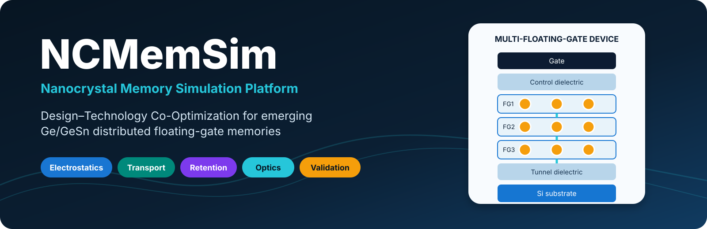
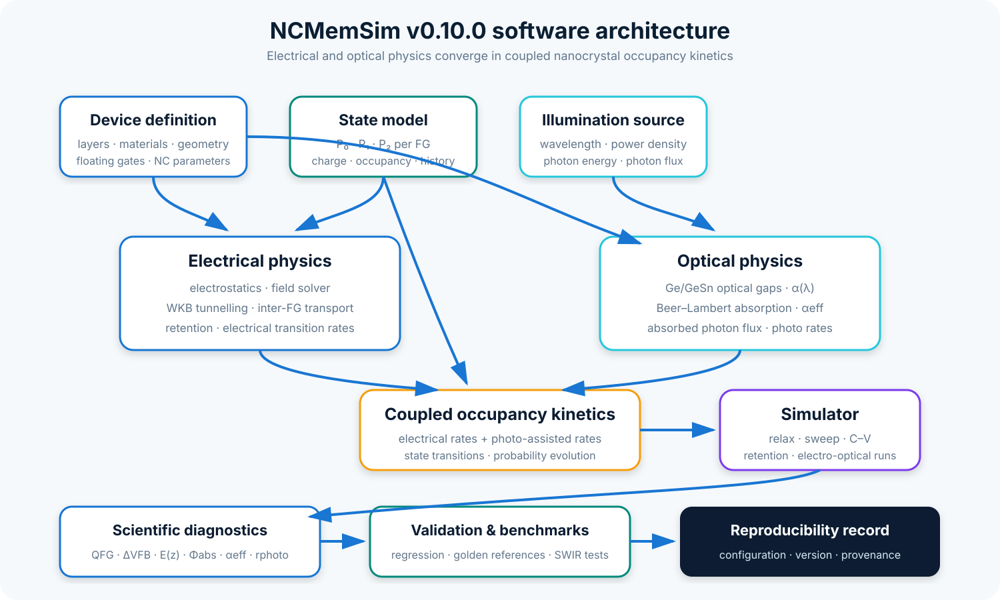
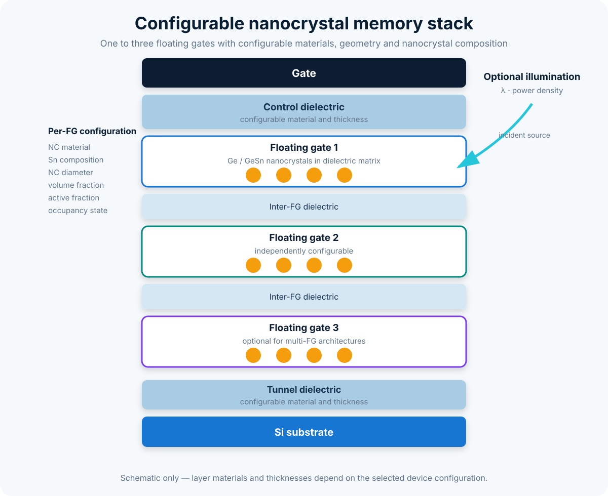
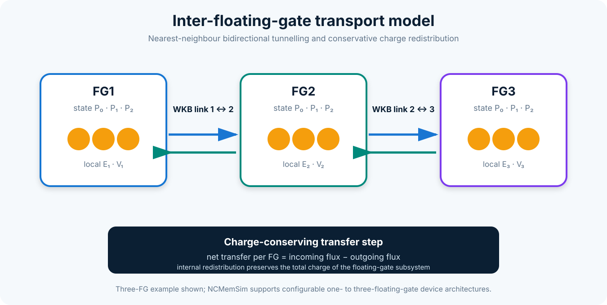
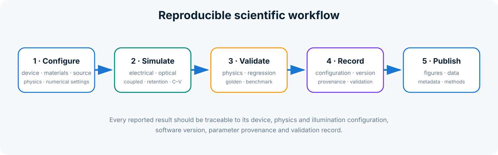

# Visual identity

> **Release context:** Included in published NCMemSim v1.10.0. See [current platform status](platform_status.md) for implemented extensions and limits. Earlier phase/version statements identify their original checkpoint or retained default path.

The NCMemSim identity combines a multilayer device stack with connected nanocrystal charge states. Canonical source files are stored in the repository-level `assets/` directory; copies in `docs/assets/` are used by MkDocs.

## Core assets

For reuse rules, palette and accessibility guidance, see the repository-level `BRANDING.md`.
